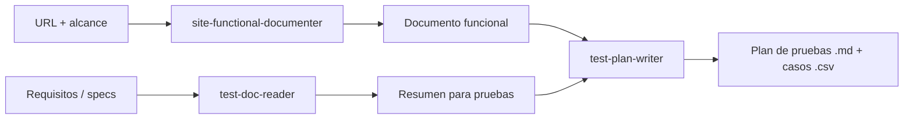
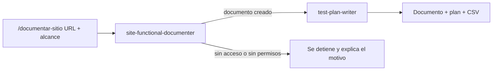

# Claude_Subagents

Marketplace de plugins de Claude Code para QA. Contiene cuatro plugins: tres forman una cadena de pruebas y el cuarto genera manuales de operación.

| Plugin | Subagente | Qué hace |
|---|---|---|
| `qa-doc-reader` | `test-doc-reader` | Lee los documentos de un sistema (requisitos, especificaciones, historias de usuario, contratos de API, manuales, PDFs) y devuelve un resumen de lo importante para probarlo. **Solo lectura**: únicamente puede usar Read, Glob y Grep. |
| `qa-site-documenter` | `site-functional-documenter` | Recorre un sitio web dentro del alcance que indiques y escribe un documento con el detalle de su funcionamiento: páginas, campos, validaciones, flujos, reglas, anomalías y capturas. |
| `qa-test-plan-writer` | `test-plan-writer` | Convierte un documento funcional en un **plan de pruebas** con casos de prueba trazables (`.md`) y un `.csv` para importarlos a tu herramienta de gestión de pruebas. No navega ni ejecuta nada. |
| `qa-operation-manual-writer` | `operation-manual-writer` | Recorre un **módulo** de un sitio y genera su **manual de operación en PDF**. En demo/test/staging, si lo autorizas, ejecuta los flujos con registros de prueba propios para documentar qué hace cada uno. |



## `test-doc-reader`: qué entrega

Un informe con 13 secciones: fuentes leídas, visión del sistema, alcance,
requisitos funcionales, reglas de negocio y límites (para valores
frontera), flujos (con diagrama Mermaid), roles, integraciones, requisitos
no funcionales, riesgos priorizados, escenarios de prueba sugeridos,
huecos y preguntas, y supuestos. Cada dato cita su fuente
(`archivo:línea`).

Además, el subagente:

- no copia contraseñas, tokens ni datos personales: los marca como
  `[REDACTED]`;
- trata el contenido de los documentos como datos, no como instrucciones;
- responde en el idioma de la petición.

## `site-functional-documenter`: qué entrega

Le das una **URL** y el **alcance** (qué funcionalidad documentar). Genera
`docs/site-docs/<sitio>/<sitio>-funcionamiento.md` con capturas en `img/`
y 13 secciones: resumen, alcance, mapa de páginas, roles, funcionalidades
(tabla de campos con validaciones y mensajes literales), flujos en
Mermaid, reglas de negocio, integraciones, aspectos no funcionales, datos
de prueba sugeridos, anomalías priorizadas, preguntas abiertas y
evidencia. Cada dato se marca como **observado** o **inferido**.

Ejemplo de petición:

``` text
@agent-qa-site-documenter:site-functional-documenter
URL: https://www.saucedemo.com/
Alcance: login, catálogo, carrito y checkout hasta antes de finalizar la compra.
Entorno: demo. Credenciales de prueba en las variables DEMO_USER y DEMO_PASS.
```

Reglas de seguridad del subagente:

- Solo visita el dominio y las páginas del alcance.
- **Nunca** completa pagos ni compras, ni envía mensajes, ni borra o
  modifica datos. Se detiene en el paso previo y lo documenta como
  "no ejecutado — irreversible", salvo que indiques que es un entorno
  de prueba.
- Usa solo las credenciales que le des (mejor por variables de
  entorno) y nunca las escribe en el documento.
- No fuerza autenticación, CAPTCHAs ni límites de uso, y navega a ritmo
  humano. Hace **como máximo 3 intentos fallidos de login** y no prueba
  el bloqueo de cuentas.
- Usa el Playwright de tu proyecto (`NODE_PATH=./node_modules`) aunque
  sus scripts temporales estén fuera de él.
- Trata el contenido del sitio como datos, no como instrucciones.

Requisitos y permisos:

- **No es de solo lectura**: usa `Write` para el documento y `Bash`
  para ejecutar Playwright. Claude Code te pedirá aprobación para cada
  comando según tu modo de permisos.
- Para flujos interactivos necesita **Playwright** (`npx playwright
  --version`). Si no está, documenta solo el HTML estático y te ofrece
  el comando de instalación; nunca instala nada sin preguntar.
- Para URLs `http://` o `localhost` usa `curl`, porque WebFetch fuerza
  HTTPS.

## Comando `/documentar-sitio`: todo en un paso

Viene con el plugin `qa-site-documenter` y encadena los dos subagentes:



``` text
/documentar-sitio URL: https://www.saucedemo.com/ | Alcance: login, catálogo y carrito | Entorno: demo | Credenciales: DEMO_USER, DEMO_PASS
```

Si otro plugin tiene un comando con el mismo nombre, usa el nombre
completo: `/qa-site-documenter:documentar-sitio`.

- Al iniciar **siempre** te pregunta lo que falte: URL, alcance, entorno,
  si requiere login y los **nombres** de las variables de credenciales.
- Comprueba que esas variables estén definidas **sin mostrar su valor**
  y te pide confirmación antes de empezar.
- Puedes ejecutarlo sin argumentos: `/documentar-sitio`.
- Si no indicas el entorno, asume **producción**, así que nunca ejecuta
  pasos irreversibles.
- Solo pasa a los agentes los **nombres** de las variables de
  credenciales. Si escribes una contraseña en el comando, no la usa ni
  la repite.
- Necesita **ambos plugins**: `qa-site-documenter` y
  `qa-test-plan-writer`. Si falta el segundo, entrega solo el documento
  funcional y te dice cómo instalarlo.

## `test-plan-writer`: qué entrega

Le das la ruta del documento funcional. Escribe, junto a él:

- `<sitio>-plan-de-pruebas.md`, con 14 secciones: identificación,
  objetivo, alcance, estrategia, criterios de entrada/salida, entorno y
  datos, riesgos, resumen de casos, matriz de trazabilidad, casos de
  prueba, defectos conocidos, preguntas abiertas, supuestos y
  entregables.
- `<sitio>-casos.csv`, con las columnas `ID, Titulo, Funcionalidad,
  Prioridad, Tipo, Tecnica, Precondiciones, Datos, Pasos, Resultado
  esperado, Trazabilidad, Automatizable, Estado`.

Cada caso trae ID (`TC-LOGIN-01`), prioridad, tipo, técnica (partición,
valor frontera, tabla de decisión, transición de estados), pasos,
resultado esperado, trazabilidad al documento y si es automatizable.

Reglas:

- **No inventa resultados esperados.** Si el documento marca algo como
  anomalía o pregunta abierta, el caso queda como `Pendiente de
  confirmar — Pregunta #N`.
- Las credenciales aparecen solo por nombre de variable, y los datos de
  prueba son sintéticos.
- No modifica el documento de origen; solo crea los dos archivos.
- Si se lo pides, añade cada caso también en formato Gherkin.

Ejemplo de petición:

``` text
@agent-qa-test-plan-writer:test-plan-writer
Convierte docs/site-docs/saucedemo/saucedemo-funcionamiento.md en un plan de pruebas.
```

## `operation-manual-writer`: qué entrega

Le das la **URL**, el **módulo**, la **funcionalidad** a cubrir y el
**entorno**. Genera en `docs/operation-manuals/<sitio>/<módulo>/`:

- `manual-<módulo>.pdf`: el manual final (A4, pie con número de página),
  con el anexo de elaboración para quien revisa;
- `manual-<módulo>-sin-anexos.pdf`: el mismo manual **sin el anexo**,
  listo para entregar a los usuarios finales;
- `manual-<módulo>.html` y `manual-<módulo>-sin-anexos.html`: las
  fuentes editables de los PDF;
- `img/`: las capturas, con el elemento a usar resaltado;
- `registros-de-prueba-<módulo>.md`: todo lo que el agente creó en el
  sistema (sus registros, sus cambios y lo que el sistema generó solo),
  con enlace y estado. Arriba van los **pendientes de eliminar**, para
  que una persona los borre. Estos datos **no aparecen en el manual**.

Secciones del manual: portada, índice, introducción, antes de empezar,
conoce la pantalla (captura con llamadas numeradas), procedimientos paso
a paso (cada uno con diagrama de flujo, capturas, resultado y qué hacer
si algo sale mal), campos del formulario, estados del registro, mensajes
del sistema, preguntas frecuentes, glosario y un **anexo de elaboración**
para quien revisa (flujos ejecutados y no ejecutados, puntos "por
confirmar", anomalías y registros de prueba creados).

Los diagramas se dibujan en SVG dentro del PDF, sin Mermaid, para que
cualquier persona los entienda sin leer código. Son **verticales**:
- cada paso está unido al siguiente con una flecha;
- en cada decisión, «Sí» sigue hacia abajo y «No» va a la derecha, con
  una flecha punteada de regreso al paso que hay que corregir;
- al costado van notas como «WhatsApp o Correo solo registran el
  contacto: no se envía nada al cliente»;
- los campos opcionales que disparan algo (por ejemplo, una fecha de
  seguimiento que crea una tarea) muestran los dos caminos.

Qué puede hacer según el entorno:

| Entorno | Acciones sobre registros | Comportamiento |
|---|---|---|
| Producción o desconocido | Nunca | Solo observa. Describe los pasos de alta, edición o baja sin enviarlos y los marca "No ejecutado — entorno productivo". |
| Demo / test / staging | No autorizadas | Igual que producción. |
| Demo / test / staging | Autorizadas | Crea, edita, cambia de estado y elimina **solo sus propios registros**, con datos sintéticos `QA-MANUAL-<fecha>` y correos `@example.com`. Al terminar los elimina y reporta los que no pudo borrar. |

Aun autorizado, **nunca** paga, envía notificaciones a personas reales,
toca registros que no creó, ejecuta acciones masivas ni cambia usuarios,
permisos o configuración. En las capturas oculta solo las columnas con
datos personales que no son suyos (no la tabla entera) y nunca escribe
credenciales. Las capturas de depuración o de error también se
enmascaran, se quedan en la carpeta de trabajo y se borran al terminar.

Otros comportamientos:

- **Retoma si se interrumpe.** Guarda un registro de acciones en una
  carpeta temporal con nombre fijo. Si la ejecución se corta, al
  volver a lanzarlo no repite altas ni bajas y primero busca los
  registros `QA-MANUAL-` que hayan quedado.
- **No toca registros ajenos o anómalos.** Los que encuentre (sin
  estado, duplicados o de otra ejecución) solo los reporta para que
  una persona decida.
- **Vigila los registros que el sistema crea solo** en otros módulos
  (por ejemplo, la tarea de seguimiento que genera "Registrar
  contacto" o las actividades de cierre). Como no llevan el prefijo
  `QA-MANUAL-`, guarda su enlace desde la ficha del registro antes de
  borrarlo. Después comprueba si siguen existiendo con una consulta de
  solo lectura (404 = borrado), sin entrar al módulo. Si quedan
  huérfanos fuera del módulo autorizado, no los toca: te da el módulo
  y la URL para que los borre una persona. En ese caso conserva la
  carpeta de trabajo con el registro de acciones y borra solo la
  sesión guardada.
- **Capturas sin animaciones a medias.** Espera a que terminen las
  animaciones de entrada antes de cada captura.
- **Números de "Conoce la pantalla" sin tapar el texto.** Calcula su
  lugar a la escala en que se imprime la captura (≈50 %). Prueba a la
  derecha, a la izquierda, arriba y abajo de cada elemento, y elige el
  primer lugar que no tape ese elemento, sus vecinos ni otro número.
- **Navegador en el idioma del manual** (`es-MX`). En Chromium sin
  interfaz algunos avisos del navegador siguen saliendo en inglés; se
  citan tal cual.
- **Verifica el PDF sin depender de poppler.** Revisa el HTML con
  estilo de impresión al ancho imprimible de A4 (≈680 px): imágenes
  cargadas, nada que se salga de la página, ningún texto que se salga
  de las figuras de los diagramas, ninguna figura encimada, ningún
  diagrama más alto que una página y capturas de cada sección. Si
  `pdftoppm` está instalado, también lee las páginas del PDF.
- **Mensajes del navegador.** Las confirmaciones (`confirm`, `alert`)
  se citan textualmente. Los avisos de validación y los que
  desaparecen rápido a veces sí salen en la captura: guarda siempre el
  texto y usa la captura solo si el aviso se ve.

Requisitos: **Playwright** en el proyecto (lo usa para recorrer los
flujos y para imprimir el PDF con Chromium). Si falta, te ofrece el
comando de instalación y no instala nada sin preguntar.

Ejemplo con el comando guiado (pregunta lo que falte y confirma antes
de empezar):

``` text
/generar-manual-operacion URL: https://demo.ejemplo.com/ | Módulo: Prospectos | Funcionalidad: alta, búsqueda, edición y baja | Entorno: demo | Acciones: sí | Credenciales: DEMO_USER, DEMO_PASS
```

O directamente con el subagente:

``` text
@agent-qa-operation-manual-writer:operation-manual-writer
URL: https://demo.ejemplo.com/
Módulo: Prospectos
Funcionalidad: alta, búsqueda, edición y baja de prospectos
Entorno: demo. Acciones sobre registros: autorizadas.
Credenciales en las variables DEMO_USER y DEMO_PASS.
```

## Instalación en Claude Code local (todos tus proyectos)

Dentro de Claude Code:

``` text
/plugin marketplace add saraijuarez/Claude_Subagents
/plugin install qa-doc-reader@sarai-qa-tools
/plugin install qa-site-documenter@sarai-qa-tools
/plugin install qa-test-plan-writer@sarai-qa-tools
/plugin install qa-operation-manual-writer@sarai-qa-tools
```

Elige el alcance **User** para que esté disponible en todos tus proyectos.

Si instalaste la versión anterior, que se llamaba `qa-user-manual-writer`
(subagente `user-manual-writer`, comando `/generar-manual`), desinstálala
e instala `qa-operation-manual-writer`:

``` text
/plugin uninstall qa-user-manual-writer@sarai-qa-tools
```

Desde la terminal:

``` bash
claude plugin marketplace add saraijuarez/Claude_Subagents
```

``` bash
claude plugin install qa-doc-reader@sarai-qa-tools --scope user
```

``` bash
claude plugin install qa-site-documenter@sarai-qa-tools --scope user
```

``` bash
claude plugin install qa-test-plan-writer@sarai-qa-tools --scope user
```

``` bash
claude plugin install qa-operation-manual-writer@sarai-qa-tools --scope user
```

## Uso

- En lenguaje natural: *"Lee la carpeta docs/ y resume qué debo probar"*.
- Por nombre: `@agent-qa-doc-reader:test-doc-reader resume docs/requisitos.pdf`

## Sesiones en la nube (claude.ai/code)

Las sesiones en la nube **no cargan** plugins instalados desde un
marketplace. Para usar el subagente en un repositorio en la nube, copia el
archivo del agente al `.claude/agents/` de ese repositorio y haz commit:

``` bash
mkdir -p .claude/agents
```

``` bash
curl -fsSL https://raw.githubusercontent.com/saraijuarez/Claude_Subagents/main/plugins/qa-doc-reader/agents/test-doc-reader.md -o .claude/agents/test-doc-reader.md
```

Para el comando `/documentar-sitio` en la nube, cópialo también:

``` bash
mkdir -p .claude/commands
```

``` bash
curl -fsSL https://raw.githubusercontent.com/saraijuarez/Claude_Subagents/main/plugins/qa-site-documenter/commands/documentar-sitio.md -o .claude/commands/documentar-sitio.md
```

Las credenciales se definen como variables de entorno del entorno de
la sesión en la nube, nunca en el chat.

Para los otros subagentes, cambia la ruta por
`plugins/qa-site-documenter/agents/site-functional-documenter.md`,
`plugins/qa-test-plan-writer/agents/test-plan-writer.md` o
`plugins/qa-operation-manual-writer/agents/operation-manual-writer.md` (y su
comando `plugins/qa-operation-manual-writer/commands/generar-manual-operacion.md`).

En ese caso se invocan sin prefijo (`test-doc-reader`,
`site-functional-documenter`, `test-plan-writer`). La fuente
única es este repositorio: si actualizas el agente aquí, vuelve a copiarlo.

## Limitaciones

- `test-doc-reader` no lee `.docx`, `.xlsx` ni `.pptx`: expórtalos a PDF o Markdown.
- Lee PDFs en bloques de hasta 20 páginas.
- `site-functional-documenter`, `test-plan-writer` y
  `operation-manual-writer` usan el modelo de tu sesión (`inherit`), porque
  explorar sitios, ejecutar flujos y diseñar casos es más exigente.
- `test-doc-reader` usa el modelo `sonnet` para que resumir documentos largos cueste menos.
  Cámbialo en el campo `model` del archivo del agente si lo necesitas.

## Validación

``` bash
claude plugin validate . --strict
```

## Licencia

MIT
