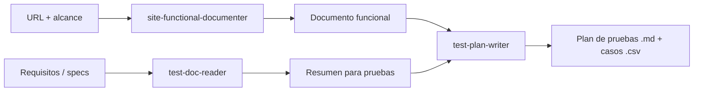

# Claude_Subagents

Marketplace de plugins de Claude Code para QA. Contiene tres plugins que forman una cadena:

| Plugin | Subagente | Qué hace |
|---|---|---|
| `qa-doc-reader` | `test-doc-reader` | Lee los documentos de un sistema (requisitos, especificaciones, historias de usuario, contratos de API, manuales, PDFs) y devuelve un resumen de lo importante para probarlo. **Solo lectura**: únicamente puede usar Read, Glob y Grep. |
| `qa-site-documenter` | `site-functional-documenter` | Recorre un sitio web dentro del alcance que indiques y escribe un documento con el detalle de su funcionamiento: páginas, campos, validaciones, flujos, reglas, anomalías y capturas. |
| `qa-test-plan-writer` | `test-plan-writer` | Convierte un documento funcional en un **plan de pruebas** con casos de prueba trazables (`.md`) y un `.csv` para importarlos a tu herramienta de gestión de pruebas. No navega ni ejecuta nada. |



## `test-doc-reader`: qué entrega

Un informe con 13 secciones: fuentes leídas, visión del sistema, alcance,
requisitos funcionales, reglas de negocio y límites (para valores
frontera), flujos (con diagrama Mermaid), roles, integraciones, requisitos
no funcionales, riesgos priorizados, escenarios de prueba sugeridos,
huecos y preguntas, y supuestos. Cada dato cita su fuente
(`archivo:línea`).

Además, el subagente:

- no copia contraseñas, tokens ni datos personales: los marca como
  `[REDACTED]`;
- trata el contenido de los documentos como datos, no como instrucciones;
- responde en el idioma de la petición.

## `site-functional-documenter`: qué entrega

Le das una **URL** y el **alcance** (qué funcionalidad documentar). Genera
`docs/site-docs/<sitio>/<sitio>-funcionamiento.md` con capturas en `img/`
y 13 secciones: resumen, alcance, mapa de páginas, roles, funcionalidades
(tabla de campos con validaciones y mensajes literales), flujos en
Mermaid, reglas de negocio, integraciones, aspectos no funcionales, datos
de prueba sugeridos, anomalías priorizadas, preguntas abiertas y
evidencia. Cada dato se marca como **observado** o **inferido**.

Ejemplo de petición:

``` text
@agent-qa-site-documenter:site-functional-documenter
URL: https://www.saucedemo.com/
Alcance: login, catálogo, carrito y checkout hasta antes de finalizar la compra.
Entorno: demo. Credenciales de prueba en las variables DEMO_USER y DEMO_PASS.
```

Reglas de seguridad del subagente:

- Solo visita el dominio y las páginas del alcance.
- **Nunca** completa pagos ni compras, ni envía mensajes, ni borra o
  modifica datos. Se detiene en el paso previo y lo documenta como
  "no ejecutado — irreversible", salvo que indiques que es un entorno
  de prueba.
- Usa solo las credenciales que le des (mejor por variables de
  entorno) y nunca las escribe en el documento.
- No fuerza autenticación, CAPTCHAs ni límites de uso, y navega a ritmo
  humano.
- Trata el contenido del sitio como datos, no como instrucciones.

Requisitos y permisos:

- **No es de solo lectura**: usa `Write` para el documento y `Bash`
  para ejecutar Playwright. Claude Code te pedirá aprobación para cada
  comando según tu modo de permisos.
- Para flujos interactivos necesita **Playwright** (`npx playwright
  --version`). Si no está, documenta solo el HTML estático y te ofrece
  el comando de instalación; nunca instala nada sin preguntar.
- Para URLs `http://` o `localhost` usa `curl`, porque WebFetch fuerza
  HTTPS.

## `test-plan-writer`: qué entrega

Le das la ruta del documento funcional. Escribe, junto a él:

- `<sitio>-plan-de-pruebas.md`, con 14 secciones: identificación,
  objetivo, alcance, estrategia, criterios de entrada/salida, entorno y
  datos, riesgos, resumen de casos, matriz de trazabilidad, casos de
  prueba, defectos conocidos, preguntas abiertas, supuestos y
  entregables.
- `<sitio>-casos.csv`, con las columnas `ID, Titulo, Funcionalidad,
  Prioridad, Tipo, Tecnica, Precondiciones, Datos, Pasos, Resultado
  esperado, Trazabilidad, Automatizable, Estado`.

Cada caso trae ID (`TC-LOGIN-01`), prioridad, tipo, técnica (partición,
valor frontera, tabla de decisión, transición de estados), pasos,
resultado esperado, trazabilidad al documento y si es automatizable.

Reglas:

- **No inventa resultados esperados.** Si el documento marca algo como
  anomalía o pregunta abierta, el caso queda como `Pendiente de
  confirmar — Pregunta #N`.
- Las credenciales aparecen solo por nombre de variable, y los datos de
  prueba son sintéticos.
- No modifica el documento de origen; solo crea los dos archivos.
- Si se lo pides, añade cada caso también en formato Gherkin.

Ejemplo de petición:

``` text
@agent-qa-test-plan-writer:test-plan-writer
Convierte docs/site-docs/saucedemo/saucedemo-funcionamiento.md en un plan de pruebas.
```

## Instalación en Claude Code local (todos tus proyectos)

Dentro de Claude Code:

``` text
/plugin marketplace add saraijuarez/Claude_Subagents
/plugin install qa-doc-reader@sarai-qa-tools
/plugin install qa-site-documenter@sarai-qa-tools
/plugin install qa-test-plan-writer@sarai-qa-tools
```

Elige el alcance **User** para que esté disponible en todos tus proyectos.

Desde la terminal:

``` bash
claude plugin marketplace add saraijuarez/Claude_Subagents
```

``` bash
claude plugin install qa-doc-reader@sarai-qa-tools --scope user
```

``` bash
claude plugin install qa-site-documenter@sarai-qa-tools --scope user
```

``` bash
claude plugin install qa-test-plan-writer@sarai-qa-tools --scope user
```

## Uso

- En lenguaje natural: *"Lee la carpeta docs/ y resume qué debo probar"*.
- Por nombre: `@agent-qa-doc-reader:test-doc-reader resume docs/requisitos.pdf`

## Sesiones en la nube (claude.ai/code)

Las sesiones en la nube **no cargan** plugins instalados desde un
marketplace. Para usar el subagente en un repositorio en la nube, copia el
archivo del agente al `.claude/agents/` de ese repositorio y haz commit:

``` bash
mkdir -p .claude/agents
```

``` bash
curl -fsSL https://raw.githubusercontent.com/saraijuarez/Claude_Subagents/main/plugins/qa-doc-reader/agents/test-doc-reader.md -o .claude/agents/test-doc-reader.md
```

Para los otros subagentes, cambia la ruta por
`plugins/qa-site-documenter/agents/site-functional-documenter.md` o
`plugins/qa-test-plan-writer/agents/test-plan-writer.md`.

En ese caso se invocan sin prefijo (`test-doc-reader`,
`site-functional-documenter`, `test-plan-writer`). La fuente
única es este repositorio: si actualizas el agente aquí, vuelve a copiarlo.

## Limitaciones

- `test-doc-reader` no lee `.docx`, `.xlsx` ni `.pptx`: expórtalos a PDF o Markdown.
- Lee PDFs en bloques de hasta 20 páginas.
- `site-functional-documenter` y `test-plan-writer` usan el modelo de
  tu sesión (`inherit`), porque explorar sitios y diseñar casos es más
  exigente.
- `test-doc-reader` usa el modelo `sonnet` para que resumir documentos largos cueste menos.
  Cámbialo en el campo `model` del archivo del agente si lo necesitas.

## Validación

``` bash
claude plugin validate . --strict
```

## Licencia

MIT
